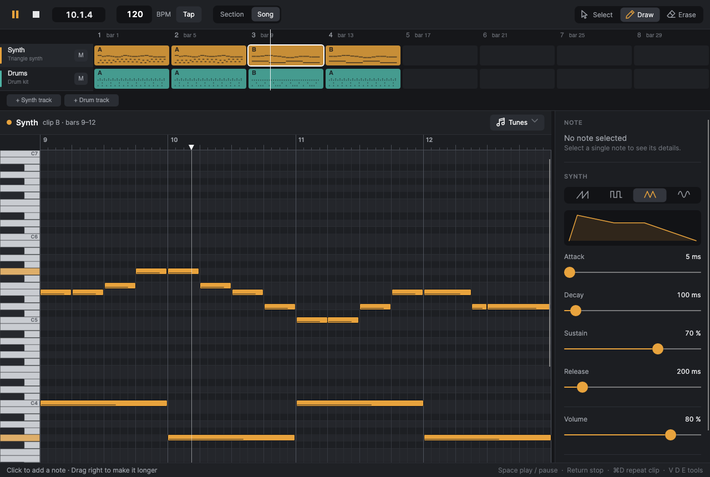
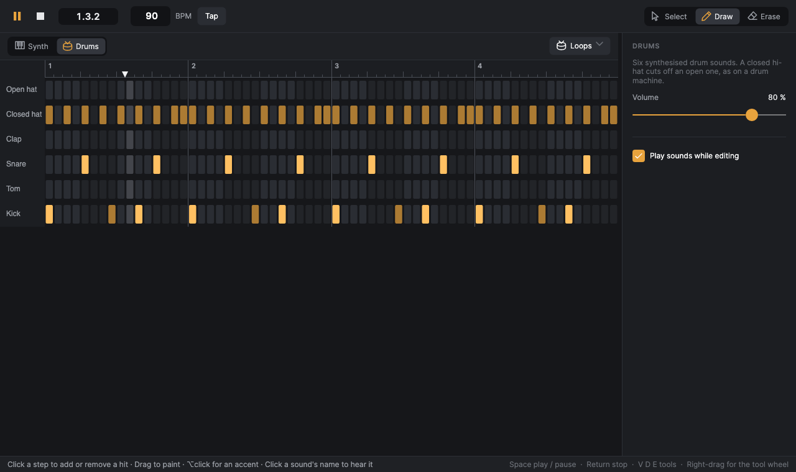

# MIDISequencer

A small music workstation written in C#: write melodies in a piano roll and beats in a drum grid, then
arrange them into a song across tracks and sections.



It started in 2015 as a WPF app for Windows. It now runs on .NET 10 with an [Avalonia](https://avaloniaui.net)
UI, so it runs natively on Apple Silicon Macs as well as Windows and Linux. The port is described in
[docs/macos-port-plan.md](docs/macos-port-plan.md).

Check the Issues page for things to do.

## Requirements

- [.NET 10 SDK](https://dotnet.microsoft.com/download/dotnet/10.0) (`global.json` pins 10.0.x)
- An audio output device

## Running

```sh
dotnet run --project Sequencer.View
```

In VS Code (with the C# Dev Kit extension), press **F5**. The **Sequencer** launch configuration builds
and runs the app.

### macOS app bundle

```sh
scripts/bundle-macos.sh            # Apple Silicon
scripts/bundle-macos.sh osx-x64    # Intel
open dist/Sequencer.app
```

This builds a self-contained, ad-hoc-signed `dist/Sequencer.app` that you can drag into Applications.
It runs on the Mac that built it. Giving it to other people would need a Developer ID signature and
notarisation.

## Tests

```sh
dotnet test
```

`Sequencer.View.Tests` includes UI tests that drive the real main window with Avalonia's headless
platform, so they need no display. `Window_RendersTheEditor` saves a screenshot to the test output folder. `dotnet test --filter Screenshot_ForTheReadme` renders the screenshot above; copy it from the test output folder to `docs/images/screenshot.png`.

## Using the sequencer

On macOS, ⌘ is the command key; on Windows and Linux it is Ctrl.

| Action | Mouse / keys |
|---|---|
| Switch tool (Select, Draw, Erase) | The toolbar buttons, the keys V / D / E, or hold right-click (or two-finger click, or Ctrl-click on macOS) and release over a slice of the tool wheel |
| Draw a note | Draw tool: click; drag to lengthen |
| Select notes | Select tool: click, drag a box, or ⌘-click to add or remove |
| Move selected notes | Select tool: drag a note (hold Shift to keep the pitch), or use the arrow keys |
| Resize a note | Select tool: drag its left or right edge |
| Erase notes | Erase tool: click; or select and press Delete / Backspace |
| Velocity | `+`/`=` and `-` (main keyboard or numeric keypad) |
| Select all / deselect | ⌘A / Esc |
| Play / pause | Space |
| Stop | Return |
| Tempo | Type in the BPM box (30-300), or click **Tap** in time |
| Play a note | Press a key on the piano keyboard; drag across keys to play each in turn |

### Arranging a song

The arrangement across the top has a row per **track** and a column per four-bar **section**. Each cell holds
a **clip** (a four-bar pattern) or nothing. Click a cell to edit its clip below; double-click an empty cell,
or use **New clip**, to start one. The same clip can play in several sections: **⌘D** (Ctrl+D) repeats the
selected clip in the next section, and editing it changes every place it plays. Right-click a cell to copy a
clip instead (a new clip to change separately), reuse another of the track's clips, or remove it.

**+ Synth track** and **+ Drum track** add tracks (up to eight), each with its own instrument; **M** mutes one.

**Section** mode loops the section you're editing while you work on it. **Song** mode plays the arrangement
from the start, up to the last clip. The position readout and the ruler show bars in the whole song.

### Drums

Select a drum track's clip for a step sequencer: six synthesised sounds (kick, snare,
clap, tom, closed and open hi-hat) across 64 sixteenth steps. Click a step to add or remove a hit, drag to
paint, ⌥/Alt-click for an accent, and click a sound's name to hear it. A closed hi-hat cuts off an open one,
as on a drum machine. Drum tracks play along with the synth tracks.

**Loops** (above a drum clip) loads a classic pattern: four on the floor, rock, boom bap, breakbeat, disco, dembow, bossa nova
or trap. Patterns are written as grids in `Sequencer.Domain/Drums/DrumLoopLibrary.cs` (`x` a hit, `X` an
accent, `.` a rest).



### Tunes

**Tunes** (above a synth clip) loads a well-known tune into it: Ode to Joy, Twinkle, Twinkle, Little Star,
Frère Jacques (as a round), Jingle Bells, Für Elise, Korobeiniki, In the Hall of the Mountain King and
Pachelbel's Canon in D. Each sets a tempo and waveform that suit it and starts playing. All are
traditional or public-domain classical pieces, cut to their best-known four bars. If the grid already has
notes, you're asked before they're replaced.

Tunes are written in a compact notation in `Sequencer.Domain/Tunes/TuneLibrary.cs`, for example
`"E4:4 E4:4 F4:4 G4:4 | ..."`: standard pitch names (middle C is C4), lengths in sixteenths, `r` for a rest
and `|` between bars. Every bar is checked to add up to 16.

Keys on the piano keyboard light up as their notes play back. Creating a note, or changing its pitch,
plays it briefly. Switch this off with **Play notes while editing**.

The panel on the right shows the selected note's pitch, velocity, start and end, and the **Synth**
settings: waveform (sawtooth, square, triangle or sine), attack, decay, sustain, release and volume.
Volume changes apply immediately; the others apply to the next note played.

## Projects

| Project | Contents |
|---|---|
| `Sequencer.Domain` | Pitches, positions, velocities, tones, settings; the song, tracks and clips; drums; tunes |
| `Sequencer.Midi` | The tempo clock (a `Stopwatch`-timed thread), tick/position maths, MIDI note numbers |
| `Sequencer.Audio` | Voices with ADSR envelopes, wavetable waveforms, previews, one mixed stream played through PortAudio |
| `Sequencer.ViewModel` | The main view model (CommunityToolkit.Mvvm) |
| `Sequencer.Visual` | Notes on the editor canvas, and input state |
| `Sequencer.View` | The Avalonia app: window, editor controls, radial menu, and Autofac set-up |
| `Sequencer.Utilities` | Small helpers |

Each project has a matching `*.Tests` project (NUnit 4 and Moq). Package versions are set centrally in
`Directory.Packages.props`.
